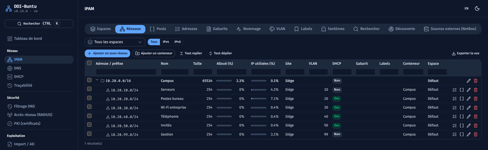
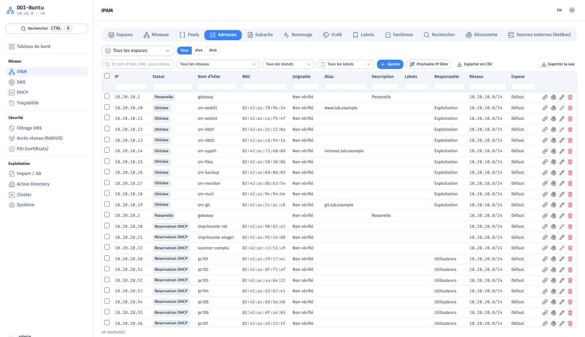
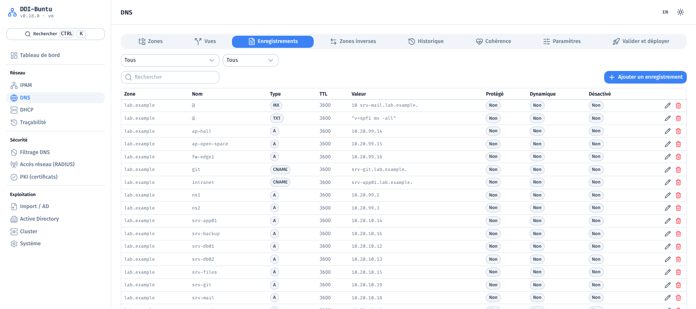
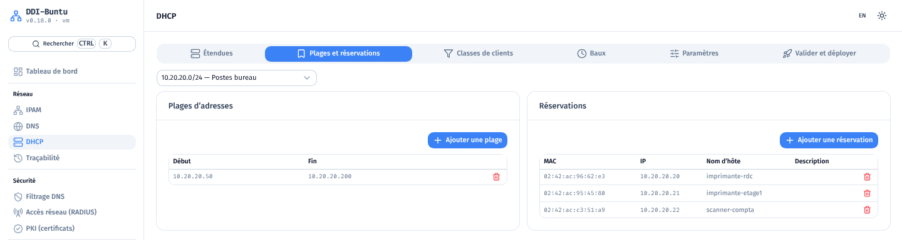
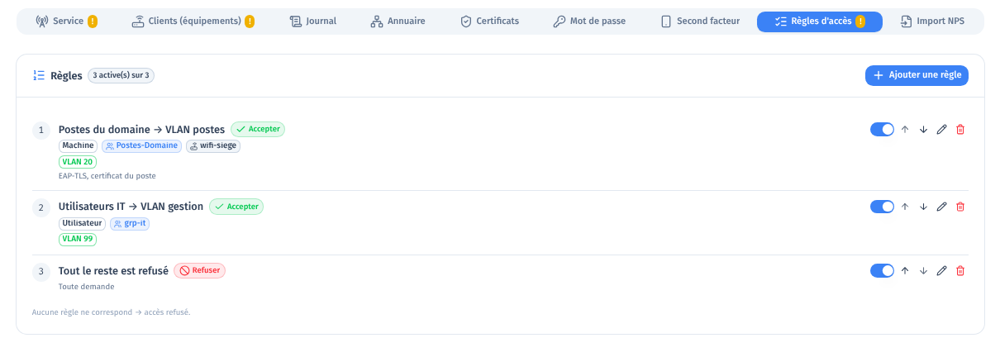

**English** · [Français](README.md)

# DDI-Buntu

**A complete DDI appliance — DNS, DHCP, IPAM, 802.1X network access and PKI — that installs itself from an ISO and is managed from a web console.**

Do you still keep your addresses in a spreadsheet, run DNS and DHCP on Windows servers, and secure your corporate Wi-Fi with an NPS and a certificate authority (AD CS) nobody dares to touch? DDI-Buntu brings all of it together in **a single Ubuntu appliance**, built on proven components (BIND 9, Kea, FreeRADIUS, EJBCA, PostgreSQL, Patroni) with a console that makes them readable.



## Why DDI-Buntu

- **Installed from a single ISO, nothing downloaded on first boot.** One ISO (BIOS + UEFI) installs everything, and the same ISO upgrades an existing installation while keeping your data.
- **One source of truth.** Allocating an address in IPAM creates the DNS record (A/AAAA and PTR) and the DHCP reservation in the same transaction; network templates apply the DHCP scope, options and naming rule when a network is created.
- **You can make mistakes safely.** A restore point is created before every configuration change, deployment or import; network changes roll back by themselves if you do not confirm them; the database can be restored to a given minute (PITR).
- **Corporate Wi-Fi and VPN without AD CS or NPS.** RADIUS (FreeRADIUS) driven from the console, access rules by Active Directory group (nested groups included), EAP-TLS, PEAP, EAP-TTLS and a second factor, with a simulation before deployment.
- **A built-in PKI.** Authorities, certificates, revocation (CRL), SCEP for network devices, publication in Active Directory, and **workstation certificates issued automatically**: the key stays on the workstation, which authenticates with its computer account.
- **End-to-end high availability.** Two data nodes and a witness: PostgreSQL (Patroni + etcd), Kea load-balancing, BIND primary/secondary, a virtual address (Keepalived) that follows the leader, RADIUS and PKI that follow the cluster, and a **guided, measured switchover** from the console.
- **Leave your current tools without starting over.** Import Windows Server DHCP/DNS exports, read Active Directory directly, import from NetBox, import an existing NPS, discover the network.
- **Secure by construction.** Verified supply chain (signatures and checksums), unprivileged console, separate and controlled privileged application, nftables firewall, encrypted secrets, full audit log, export to a SIEM, OpenID Connect SSO and API tokens.

> Status: development version **0.18.0**. See "Known limitations" below before any production use.

## The console in pictures

Screenshots of the real console (version 0.18.0) with fictitious demonstration data.

### All your addresses, with names, MACs and DNS aliases



### DNS that follows IPAM



### DHCP: ranges and reservations per network



### Network access: readable rules, played from top to bottom



The console itself is in French and English.

## What the console contains

HTTPS web console in French and English, light and dark themes, addressable tabs, global search (`Ctrl+K`).

| Module | What you do there |
|---|---|
| **IPAM** | Overlapping IP spaces, containers / networks / pools, VLANs, templates, naming rules, labels, ghost addresses, network discovery, external sources (NetBox) |
| **DNS** (BIND 9) | Primary, secondary and forward zones, views, records, reverse zones, history with rollback, consistency check, response rate limiting (RRL) |
| **DHCP** (Kea) | Scopes, ranges, reservations, client classes, leases, high availability |
| **DNS filtering** | Pi-hole-style cockpit (query log, top lists, one-click allow/block, pause), hosts / domains / adblock lists, DNS tunnel detection |
| **Network access** (RADIUS) | Wi-Fi, VPN and switch clients, Active Directory directory, EAP-TLS, password (PEAP, EAP-TTLS), second factor, access rules with simulation, authentication log |
| **PKI** (EJBCA) | Authorities and CRLs, certificates, SCEP, publication in AD, workstation certificates, backup, updates |
| **Import / AD** | Windows DHCP/DNS exports, zone transfer, LDAP, NetBox, NPS |
| **Cluster** | State, hot settings (virtual address, dedicated network, certificates renewed without interruption), guided switchover test |
| **System** | Alerts (36 rules, silencing, signed webhook, e-mail), scheduled backups and point-in-time restore, online updates with automatic rollback, firewall |

## Quick start

```bash
git clone <repository-URL> ddibuntu && cd ddibuntu
tools/build-console.sh          # Node 22 or Docker; builds webui/.output
./build-ddibuntu.sh             # macOS/Windows: through Docker; Linux: native (root) or Docker
```

Without cloning: download the single file `build-ddibuntu.sh` (or `build-ddibuntu.ps1` on Windows) from a *release*. Details, corporate proxies and a VMware trial: [docs/INSTALL.md](docs/INSTALL.md) (in French).

## Repository layout

```
build-ddibuntu.sh        entry point: builds the ISO (repository mode, or single release file)
src/rootfs/              files installed on the appliance (wizard, menu, firewall, rollback, systemd units…)
src/iso/                 unattended installation (Subiquity) and late-commands script
src/ps1/                 template of the Windows launcher
src/VERSION              single version number
webui/                   web console (Nuxt 4 + Nuxt UI 4, Nitro server, PostgreSQL)
tools/                   console build, single file, test databases, translations
tests/                   shell batteries b01..b22 (system, ISO, QEMU, cluster, backups); webui/tests: vitest
docs/                    architecture, installation, tests, release (in French)
```

## Development

| Need | Command |
|---|---|
| Build the console | `make console` |
| Typing and console unit tests | `make test-unit` |
| Console end-to-end tests (PostgreSQL) | `tools/setup-test-db.sh` then `make test-e2e` |
| Shell batteries (Linux, root, QEMU, Ubuntu chroot) | `make test-shell` — see [docs/TESTING.md](docs/TESTING.md) |
| Single release file | `make single` — see [docs/RELEASING.md](docs/RELEASING.md) |

Working principles: a feature is only "done" when a real test has proven it; a failing test is first suspected of being wrong, then verified; no real data (messages, customers, secrets) in tests.

## Cluster (under construction — iteration 5 of 6)

Two data nodes + a witness, on a dedicated network; architecture and decisions: [docs/ARCHITECTURE-CLUSTER.md](docs/ARCHITECTURE-CLUSTER.md).

```
# node 1 (the one that already holds the database)
ddibuntu-cluster init --name n1 --ip 10.9.0.1 --net 10.9.0.0/24
# option: a service virtual address that follows the PostgreSQL leader
#   ddibuntu-cluster init ... --vip 192.0.2.10/24 --vip-iface ens192 [--vip-vrid 51]
# on node 1, one bundle per new node (the passphrase is displayed only once)
ddibuntu-cluster bundle --name n3 --ip 10.9.0.3 --role witness     # witness
ddibuntu-cluster bundle --name n2 --ip 10.9.0.2 --role data
# on the new node, after copying the bundle (a data node's local database is replaced)
ddibuntu-cluster join n2.bundle --wipe-local-db
ddibuntu-cluster status          # JSON state
ddibuntu-cluster switchover      # controlled switchover
```

Add the witness first, then the second data node. As soon as two data nodes exist, Kea switches to **HA load-balancing** (configuration added by root; `ddibuntu-cluster status` shows the HA state): DHCP relays must list both real node addresses. BIND becomes **primary/secondary**: root derives the secondary from the replicated configuration, and it receives zones (and the RPZ) by TSIG-signed transfer over the dedicated network. For a single service address, add a **virtual IP** that follows the PostgreSQL leader (Keepalived; see `docs/ARCHITECTURE-CLUSTER.md`). The console's **"Cluster" page** shows the state and allows a controlled switchover; BIND is promoted automatically when Patroni changes leader, and a secondary console node is read-only (use the service address). **Online update**: secondaries first, then switchover, then the former leader (the leader refuses to update until the secondaries are up to date).

## Known limitations

- Never run on **real VMware**, **real Docker Desktop** or **PowerShell 5.1**. Automatic workstation certificate enrolment (0.18.0) is verified against a real Samba AD, but not yet on a **real Windows workstation** (`certreq`, scheduled task, GPO): try it on a pilot workstation first.
- DDNS received by BIND is overwritten at the next deployment. Kea 2.4 (Ubuntu 24.04) has no GSS-TSIG: the appliance's DNS server does accept secure updates from domain machines (0.5.6), but sending DHCP records to Active Directory controllers over GSS-TSIG (Kea 3.x or `nsupdate -g`) is not done. Kerberos authentication has only been tried with an MIT KDC, not with a real Active Directory.
- Self-signed console TLS certificate; high availability still under construction (see above); no per-client or regular-expression rules in filtering.
- Network discovery reads ARP from `/proc/net/arp`; ping depends on system settings.

## License

**To be defined**: no `LICENSE` file is provided until the choice is made; without a license, all rights are reserved. Third-party components: [OPEN-SOURCE.md](OPEN-SOURCE.md).
