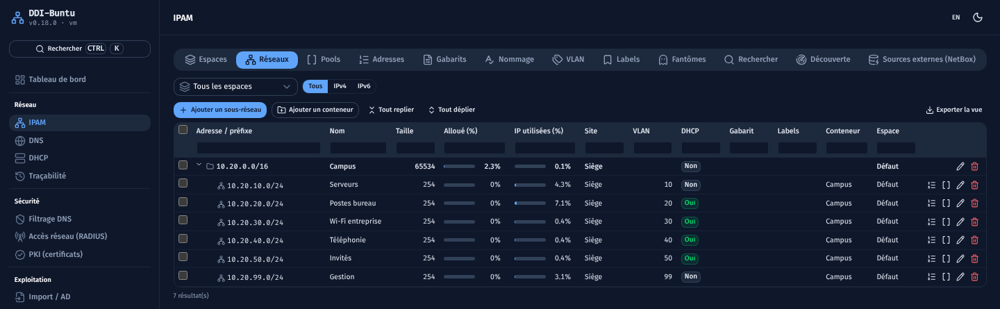
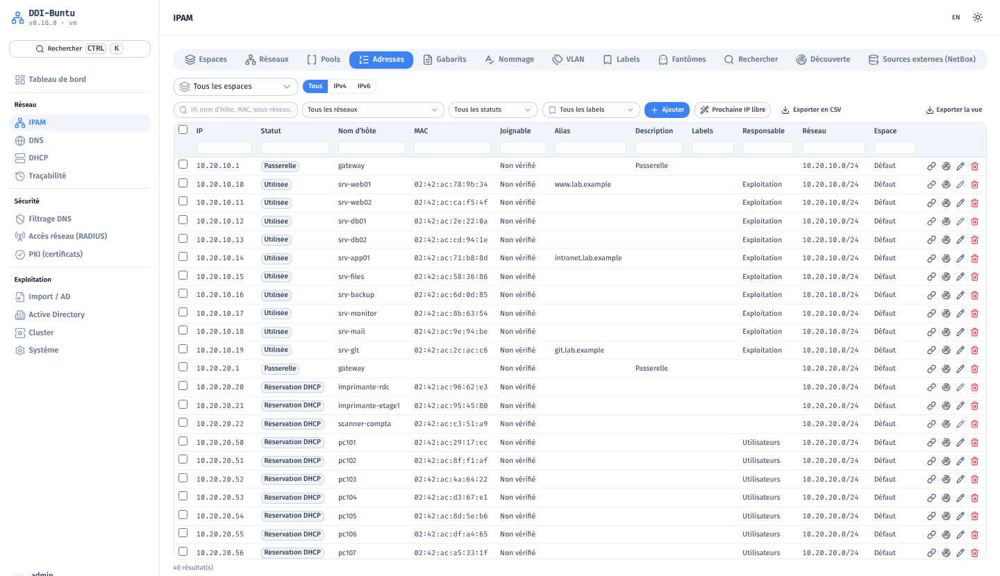
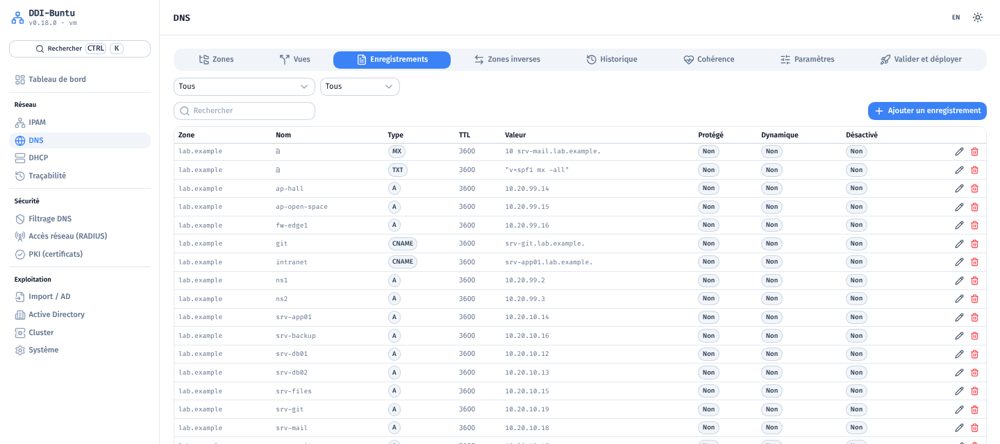
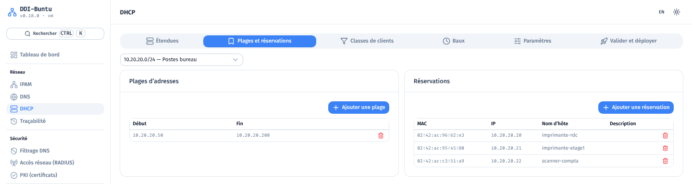
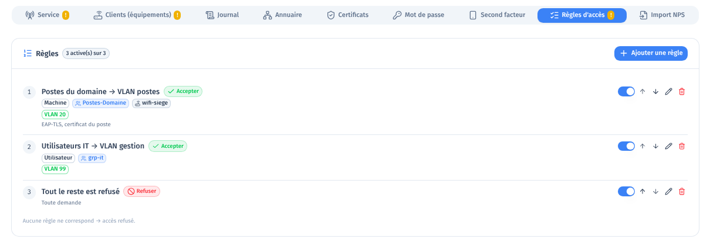

[English](README.en.md) · **Français**

# DDI-Buntu

**Une appliance DDI complète — DNS, DHCP, IPAM, accès réseau 802.1X et PKI — qui s'installe seule depuis une ISO et se pilote depuis une console web.**
*(English version: [README.en.md](README.en.md).)*

Vous gérez aujourd'hui vos adresses dans un tableur, votre DNS et votre DHCP sur des serveurs Windows, votre Wi-Fi d'entreprise avec un NPS et une autorité AD CS que personne n'ose toucher ? DDI-Buntu réunit tout cela dans **une seule appliance Ubuntu**, avec des composants éprouvés (BIND 9, Kea, FreeRADIUS, EJBCA, PostgreSQL, Patroni) et une console qui les rend lisibles.



## Pourquoi DDI-Buntu

- **Installé depuis une seule ISO, sans rien télécharger au premier démarrage.** Une ISO (BIOS + UEFI) installe tout, et la même ISO met à niveau une installation existante en gardant vos données.
- **Une source de vérité.** Allouer une adresse dans l'IPAM crée l'enregistrement DNS (A/AAAA et PTR) et la réservation DHCP dans la même transaction ; les gabarits de réseau appliquent étendue, options et règle de nommage dès la création.
- **On peut se tromper sans risque.** Un point de restauration est créé avant chaque configuration, déploiement ou import ; les changements réseau s'annulent d'eux-mêmes si vous ne les confirmez pas ; la base se restaure à la minute près (PITR).
- **Le Wi-Fi et le VPN d'entreprise, sans AD CS ni NPS.** RADIUS (FreeRADIUS) piloté depuis la console, règles d'accès par groupe Active Directory (groupes imbriqués compris), EAP-TLS, PEAP, EAP-TTLS et second facteur, avec une simulation avant déploiement.
- **Une PKI intégrée.** Autorités, certificats, révocation (CRL), SCEP pour les équipements réseau, publication dans l'Active Directory, et **certificats de postes émis automatiquement** : la clé reste sur le poste, le poste s'authentifie avec son compte d'ordinateur.
- **Haute disponibilité de bout en bout.** Deux nœuds de données et un arbitre : PostgreSQL (Patroni + etcd), Kea en répartition de charge, BIND primaire/secondaire, adresse virtuelle (Keepalived) qui suit le leader, RADIUS et PKI qui suivent le cluster, **bascule guidée et mesurée** depuis la console.
- **Vous quittez vos outils actuels sans repartir de zéro.** Import des exports DHCP/DNS de Windows Server, lecture directe de l'Active Directory, import NetBox, import d'un NPS existant, découverte réseau.
- **Sûr par construction.** Chaîne d'approvisionnement vérifiée (signatures et empreintes), console sans privilège, application privilégiée séparée et contrôlée, pare-feu nftables, secrets chiffrés, journal d'audit complet, export vers un SIEM, SSO OpenID Connect et jetons d'API.

> État : version de développement **0.18.0**. Voir « Limites connues » ci-dessous avant tout usage en production.

## La console en images

Captures prises sur la console réelle (version 0.18.0) avec des données de démonstration fictives.

### Toutes vos adresses, avec leurs noms, leurs MAC et leurs alias DNS



### Le DNS qui suit l'IPAM



### DHCP : plages et réservations par réseau



### Accès réseau : des règles lisibles, jouées de haut en bas



## Ce que contient la console

Console web HTTPS en français et en anglais, thèmes clair et sombre, onglets adressables, recherche globale (`Ctrl+K`).

| Module | Ce que vous y faites |
|---|---|
| **IPAM** | Espaces IP qui se chevauchent, conteneurs / réseaux / pools, VLAN, gabarits, règles de nommage, labels, adresses fantômes, découverte réseau, sources externes (NetBox) |
| **DNS** (BIND 9) | Zones primaires, secondaires et de redirection, vues, enregistrements, zones inverses, historique avec retour arrière, contrôle de cohérence, limitation de débit (RRL) |
| **DHCP** (Kea) | Étendues, plages, réservations, classes de clients, baux, haute disponibilité |
| **Filtrage DNS** | Cockpit façon Pi-hole (journal des requêtes, tops, liste blanche/noire en un clic, pause), listes hosts / domaines / adblock, détection de tunnels DNS |
| **Accès réseau** (RADIUS) | Clients Wi-Fi, VPN et commutateurs, annuaire Active Directory, EAP-TLS, mot de passe (PEAP, EAP-TTLS), second facteur, règles d'accès avec simulation, journal des authentifications |
| **PKI** (EJBCA) | Autorités et CRL, certificats, SCEP, publication dans l'AD, certificats de postes, sauvegarde, mises à jour |
| **Import / AD** | Exports Windows DHCP/DNS, transfert de zone, LDAP, NetBox, NPS |
| **Cluster** | État, réglages à chaud (adresse virtuelle, réseau dédié, certificats renouvelés sans interruption), test de bascule guidé |
| **Système** | Alertes (36 règles, mise en silence, webhook signé, e-mail), sauvegardes planifiées et restauration à un instant donné, mises à jour en ligne avec retour arrière automatique, pare-feu |

## Démarrage rapide

```bash
git clone <URL-du-dépôt> ddibuntu && cd ddibuntu
tools/build-console.sh          # Node 22 ou Docker ; construit webui/.output
./build-ddibuntu.sh             # macOS/Windows : via Docker ; Linux : natif (root) ou Docker
```

Sans cloner : télécharger le fichier unique `build-ddibuntu.sh` (ou `build-ddibuntu.ps1` sous Windows) d'une *release*. Détails, proxys d'entreprise et essai sous VMware : [docs/INSTALL.md](docs/INSTALL.md).

## Organisation du dépôt

```
build-ddibuntu.sh        point d'entrée : construit l'ISO (mode dépôt, ou fichier unique de publication)
src/rootfs/              fichiers installés sur l'appliance (assistant, menu, pare-feu, retour arrière, unités systemd…)
src/iso/                 installation automatique (Subiquity) et script late-commands
src/ps1/                 modèle du lanceur Windows
src/VERSION              numéro de version unique
webui/                   console web (Nuxt 4 + Nuxt UI 4, serveur Nitro, PostgreSQL)
tools/                   construction de la console, fichier unique, bases de test, traductions
tests/                   batteries shell b01..b22 (système, ISO, QEMU, cluster, sauvegardes) ; webui/tests : vitest
docs/                    architecture, installation, tests, publication
```

## Développement

| Besoin | Commande |
|---|---|
| Construire la console | `make console` |
| Typage et tests unitaires de la console | `make test-unit` |
| Tests de bout en bout de la console (PostgreSQL) | `tools/setup-test-db.sh` puis `make test-e2e` |
| Batteries shell (Linux, root, QEMU, chroot Ubuntu) | `make test-shell` — voir [docs/TESTING.md](docs/TESTING.md) |
| Fichier unique de publication | `make single` — voir [docs/RELEASING.md](docs/RELEASING.md) |

Principes de travail : une fonction n'est « faite » que si un test réel l'a prouvée ; un test qui échoue est d'abord soupçonné d'être faux, puis vérifié ; aucune donnée réelle (messages, clients, secrets) dans les tests.

## Cluster (en construction — itération 5 sur 6)

Deux nœuds de données + un arbitre, sur un réseau dédié ; architecture et décisions : [docs/ARCHITECTURE-CLUSTER.md](docs/ARCHITECTURE-CLUSTER.md).

```
# nœud 1 (celui qui porte déjà la base)
ddibuntu-cluster init --name n1 --ip 10.9.0.1 --net 10.9.0.0/24
# option : adresse virtuelle de service qui suit le leader PostgreSQL
#   ddibuntu-cluster init ... --vip 192.0.2.10/24 --vip-iface ens192 [--vip-vrid 51]
# sur le nœud 1, un lot par nouveau nœud (la phrase de passe s'affiche une seule fois)
ddibuntu-cluster bundle --name n3 --ip 10.9.0.3 --role witness     # arbitre
ddibuntu-cluster bundle --name n2 --ip 10.9.0.2 --role data
# sur le nouveau nœud, après copie du lot (la base locale d'un nœud de données est remplacée)
ddibuntu-cluster join n2.bundle --wipe-local-db
ddibuntu-cluster status          # état JSON
ddibuntu-cluster switchover      # bascule contrôlée
```
Ajoutez d'abord l'arbitre, puis le second nœud de données. Dès que deux nœuds de données existent, Kea passe en **HA load-balancing** (configuration ajoutée par root ; `ddibuntu-cluster status` montre l'état HA) : les relais DHCP doivent lister les deux adresses réelles des nœuds. BIND devient **primaire/secondaire** : le secondaire est dérivé par root de la configuration répliquée et reçoit les zones (et la RPZ) par transfert signé TSIG sur le réseau dédié. Pour une adresse de service unique, ajoutez une **IP virtuelle** qui suit le leader PostgreSQL (Keepalived ; voir `docs/ARCHITECTURE-CLUSTER.md`). La **page « Cluster »** de la console montre l'état et permet la bascule contrôlée ; BIND est promu automatiquement quand Patroni change de leader et un nœud secondaire de la console est en lecture seule (utilisez l'adresse de service). **Mise à jour en ligne** : secondaires d'abord, puis bascule, puis l'ancien leader (le leader refuse tant que les secondaires ne sont pas à jour).

## Limites connues

- Jamais exécuté sur **VMware réel**, **Docker Desktop réel** ni **PowerShell 5.1**. L'enrôlement automatique des certificats de postes (0.18.0) est vérifié contre un vrai Samba AD, mais pas encore sur un **vrai poste Windows** (`certreq`, tâche planifiée, GPO) : à essayer d'abord sur un poste pilote.
- Le DDNS reçu par BIND est écrasé au déploiement suivant. Kea 2.4 (Ubuntu 24.04) n'a pas GSS-TSIG : le serveur DNS de l'appliance accepte bien les mises à jour sécurisées des machines du domaine (0.5.6), mais l'envoi des enregistrements DHCP vers les contrôleurs Active Directory en GSS-TSIG (Kea 3.x ou `nsupdate -g`) n'est pas fait. L'authentification Kerberos n'a été essayée qu'avec un KDC MIT, pas avec un vrai Active Directory.
- Certificat TLS de la console auto-signé ; haute disponibilité en cours de construction (voir ci-dessus) ; pas de règles par client ni par expression régulière dans le filtrage.
- La découverte réseau lit l'ARP dans `/proc/net/arp` ; le ping dépend des réglages du système.

## Licence

**À définir** : aucun fichier `LICENSE` n'est fourni tant que le choix n'est pas fait ; sans licence, tous droits sont réservés. Composants tiers : [OPEN-SOURCE.md](OPEN-SOURCE.md).
